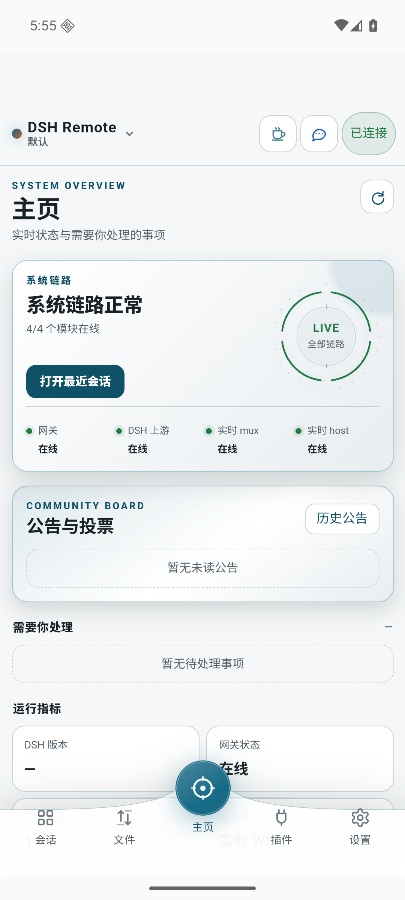
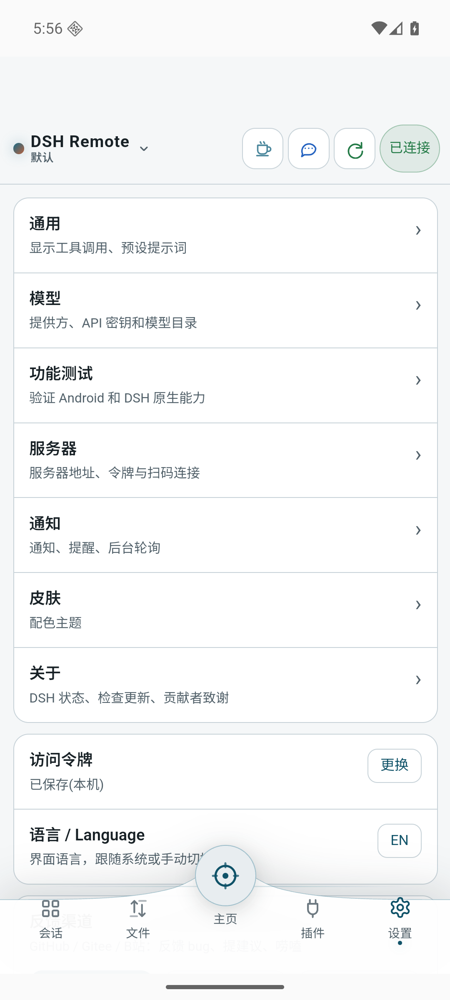
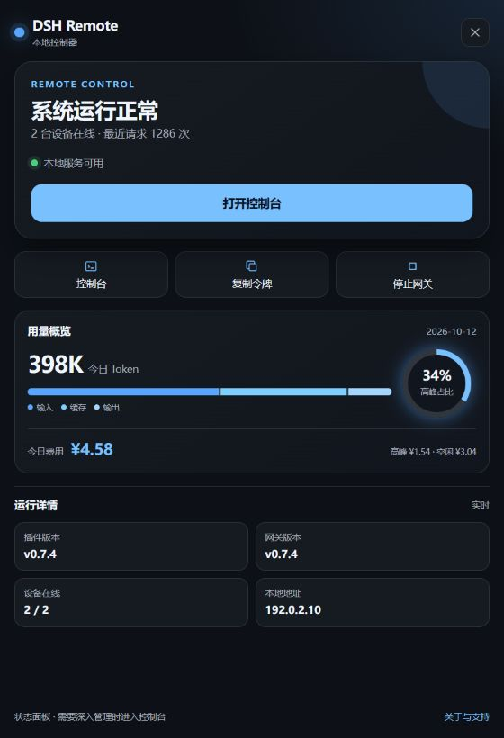
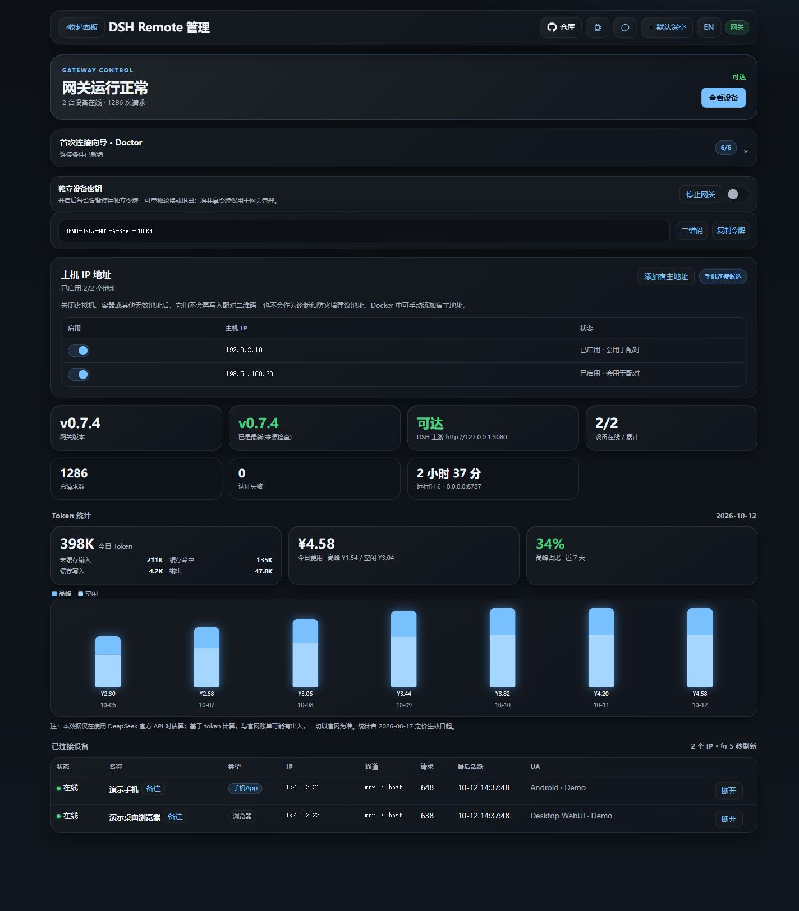
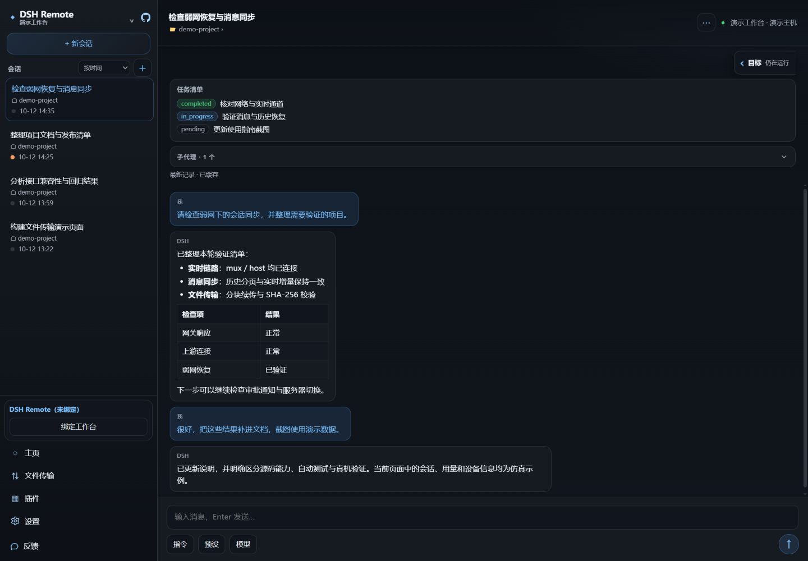

# DSH Remote

> Continue your DSH work from a phone or another computer: read sessions, answer approvals and questions, transfer files, and inspect the host.

[English](README.en.md) · [中文](README.md)

[](https://www.npmjs.com/package/dsh-remote-plugin)
[](https://github.com/Blank-not-black/dsh-Remote/releases/latest)
[](https://github.com/Blank-not-black/dsh-Remote/actions/workflows/release-build.yml)
[](https://github.com/Blank-not-black/dsh-Remote/actions/workflows/compat.yml)
[](LICENSE)
[](https://dshbase.com/plugins/dsh-Remote/)
[](https://www.dsh.so/artifact/dsh-remote-2/)
[](https://www.dsh.so/artifact/dsh-remote-2/)
[](https://awesome-dsh-plugin.com)
[](https://dsh.fish/a/dsh-remote-plugin)
[](https://dshplugin.dev/plugins/blank-not-black-dsh-remote-plugin)
[](https://dshfind.com/en/plugins/Blank-not-black/dsh-Remote?ref=badge)

DSH Remote consists of a DSH plugin, a single-file gateway, and clients. The plugin adds the DSH entry point and manages the gateway. The gateway handles authentication, HTTP/realtime proxying, and files. Clients include Android, mobile/desktop WebUI, and the HarmonyOS source project.

[Documentation](docs/README.md) · [Installation](docs/getting-started.md) · [Troubleshooting](docs/troubleshooting.md) · [Downloads](https://github.com/Blank-not-black/dsh-Remote/releases/latest) · [Issues](https://github.com/Blank-not-black/dsh-Remote/issues)

The detailed guides are currently in Chinese. This page and the plugin README provide an English overview and installation path.

## Capabilities

| Area | Features |
| --- | --- |
| Sessions | History and realtime messages, model/reasoning selection, approvals, questions, goals, queues and subagents |
| Files and images | Host browsing, previews, downloads, resumable chunks and image attachments |
| Host status | Gateway/DSH status, mux/host channels, devices, tokens and cost estimates |
| Plugins | Installed/discovered plugins, details, configuration toggles and operation records |
| Session insights | Optional dsh-context summaries and dsh-cost-meter costs/quotas |
| Weak networks and recovery | Independent long polling, WS backoff, local history, gzip/ETag and bounded crash recovery |
| Connections and themes | Multiple pairing addresses, groups, LAN/Tailscale and five Web themes |

Mobile navigation is **Sessions, Files, Home, Plugins, Settings**. Usage summaries remain on Home and in sessions. Desktop provides a wider workbench and drawers. See [platform differences](docs/usage.md).

Image understanding depends on DSH and the model. Cost estimates do not replace provider bills. Insights require the corresponding host plugins and display unavailable states when data is missing. DSH UI renders a [safe read-only subset](docs/dsh-ui-support.md).

## Quick start: DSH Web plugin

Confirm that DSH Web works, then run as the same user:

```sh
dsh plugin --profile web add dsh-remote-plugin@latest
dsh plugin --profile web list --depth 0
```

1. Fully restart DSH Web, hard-refresh with Ctrl+F5, and open DSH Remote in the sidebar.
2. Confirm the gateway is running and open `http://127.0.0.1:8787/health` on the host.
3. Generate a pairing QR code in the admin console and scan it in Settings → Servers.
4. For manual pairing, use `http://PC-LAN-IP:8787` and the token. A phone's localhost refers to the phone.

The example targets the `web` profile; use your actual profile name. DSH Desktop uses its own plugin manager and requires a complete exit/reopen. Installing into Web does not install into Desktop. RC packages use `@next`; check npm to confirm the current tag.

For standalone gateways, multiple addresses, pinned versions and Git-source installation, see the [installation guide](docs/getting-started.md). A standalone executable can run with `--supervise`; defaults are `0.0.0.0:8787` and upstream `http://127.0.0.1:3080`.

> Pairing QR codes contain credentials. Use a trusted LAN or Tailscale; keep tokens private and avoid directly exposing the gateway to the public Internet.

## Screenshots

Updated on 2026-10-12. Phone images show the actual 0.7.4 APK running in an Android 16 emulator; desktop, plugin panel and admin images were captured in a browser. Sessions, usage, devices and addresses are simulated; no real profile or credentials were used. No physical-phone or HarmonyOS captures were taken. [All 19 screenshots and provenance](docs/screenshots/README.md).

<table>
  <tr>
    <td align="center"></td>
    <td align="center"></td>
  </tr>
</table>

<p align="center"></p>
<p align="center"></p>

<p align="center"></p>

## Downloads and platform status

[Releases](https://github.com/Blank-not-black/dsh-Remote/releases) lists versions; [Latest](https://github.com/Blank-not-black/dsh-Remote/releases/latest) is the stable entry point. RCs are separate validation releases.

| Platform | Distribution |
| --- | --- |
| Android | `dsh-remote.apk`, Capacitor shell; permissions and device behavior need device validation |
| Windows x64 | `dsh-remote-win-x64.exe`, no separate Node installation |
| Linux x64 | `dsh-remote-linux-x64`, grant executable permission |
| Browser | Connect to the gateway for mobile/desktop WebUI |
| HarmonyOS | ArkTS/ArkUI source; [build and sign yourself](docs/harmonyos-self-build.md); current release CI does not build HAPs |
| macOS | Outside the main release workflow; older preview assets are not promised for every version |

Documentation was checked against repository **0.7.4 on 2026-10-12**. HarmonyOS still declares **0.6.26**. This does not independently verify current GitHub/npm/Gitee distribution or Android/HarmonyOS device behavior.

Windows Desktop start/restart is experimental and requires a verified instance and trusted launch configuration. The gateway must stay online; Remote does not register a Windows service or login-start task. See [configuration and limits](docs/configuration.md).

## Documentation and development

[Documentation index](docs/README.md) links installation, usage, configuration, troubleshooting, [plugin management](docs/plugin-center.md), [session insights](docs/plugin-insights.md), [development](docs/development.md), [modules](docs/modules/README.md), [compatibility](docs/compatibility.md), [release](docs/release.md), and [historical records](docs/archive/README.md).

The gateway has no runtime dependencies; the WebUI is plain JavaScript without a build step. The repository retains existing Capacitor/AndroidX and vendored browser assets. Add no new dependencies and follow [AGENTS.md](AGENTS.md). Edit root sources, then sync the plugin.

```sh
npm ci
npm run sync-plugin
npm run check
git diff --check
```

`npm run build-app` builds Android; `npm run publish` prepares local APK/update files and does not publish npm. `npm run release <version>` stages all non-ignored changes, commits, pushes and updates the tag; it requires the release scope to be accepted. Its `--dry-run` still writes local version files.

## Contributors and thanks

The offline credits list includes [Blank-not-black](https://github.com/Blank-not-black), [wikkd](https://github.com/wikkd), [anupamme](https://github.com/anupamme), and [liuchang-t](https://github.com/liuchang-t). See [GitHub Contributors](https://github.com/Blank-not-black/dsh-Remote/graphs/contributors) for the full history. This list is not a newly queried contribution ranking.

## License

[MIT](LICENSE)
