# 项目截图与来源

[文档首页](../README.md) · [客户端使用](../usage.md) · [尺寸与 SHA-256 清单](manifest.json)

## rc.9 手机 WebUI（2026-10-22）

以下两张来自 `0.8.0-rc.9` 源码的实际手机 WebUI，使用临时 HOME、固定测试令牌和 `tests/fixtures/realistic-stack.cjs` 的隔离示例主机。展示默认蓝色大肥鱼、完成引导后的会话首页，以及融入“偏好与维护”列表的新手引导入口。没有读取真实 profile、提交反馈或调用模型；浏览器截图不代表 Android/HarmonyOS 实机验收。页面未重绘、图片未修饰。

| 文件 | 内容 |
| --- | --- |
| [mobile-home-0.8.0-rc.9-web.jpg](mobile-home-0.8.0-rc.9-web.jpg) | 完成引导后首页不再显示学习入口 |
| [mobile-more-0.8.0-rc.9-web.jpg](mobile-more-0.8.0-rc.9-web.jpg) | 更多页普通设置行与鱼皮肤小头像 |

两张新图的尺寸与摘要单独记录在 [rc.9 清单](rc9-manifest.json)，不改写旧图的原始清单。本轮本地布局与交互记录在 `dist/rc9-guide-polish-2026-10-22/`。

## 0.7.4 历史截图库

截图日期：2026-10-12。共 19 张：7 张 Android 模拟器中的 APK 截图、12 张 Chromium 浏览器截图。使用仓库 0.7.4 的实际界面与本地资源，没有重新绘制界面或修改截图像素。

会话、插件、文件列表、费用、设备与地址均为示例数据。演示使用 `tests/fixtures/realistic-stack.cjs` 启动临时 DSH 上游与真实 Remote 网关，再通过仅监听 127.0.0.1 的代理提供示例响应和初始连接设置。没有读取真实 DSH profile、真实令牌、账户费用或会话；没有调用模型或安装插件。

图片中的 `DEMO-ONLY-NOT-A-REAL-TOKEN` 仅属于临时仿真环境；192.0.2.x 和 198.51.100.x 为示例地址。Doctor、在线设备、版本、费用和“已验证”等显示是演示数据，不构成真实防火墙、设备或弱网测试结论。

## Android App

实际安装并运行 `apk/dsh-remote.apk`（0.7.4 / versionCode 7049），设备为专用 Pixel 7 AVD，Android 16 / API 36 Google APIs x86_64；官方 Emulator 37.2.12 使用 WHPX 加速、电脑显卡渲染。图片均为 ADB 直接截取的 1080×2400 PNG，保留系统状态栏、导航栏与键盘。App 使用中文和默认浅色主题，通过正常深链入口连接隔离演示网关；演示代理为 App 来源补充 CORS 响应，生产代码与 APK 保持原状。

<table>
  <tr>
    <td align="center"> 主页</td>
    <td align="center"> 设置</td>
  </tr>
  <tr>
    <td align="center">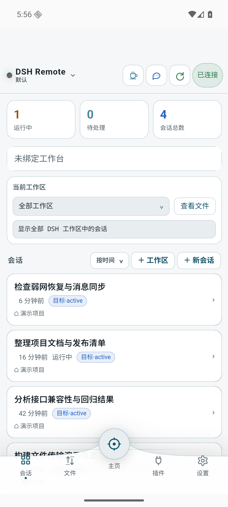 会话列表</td>
    <td align="center">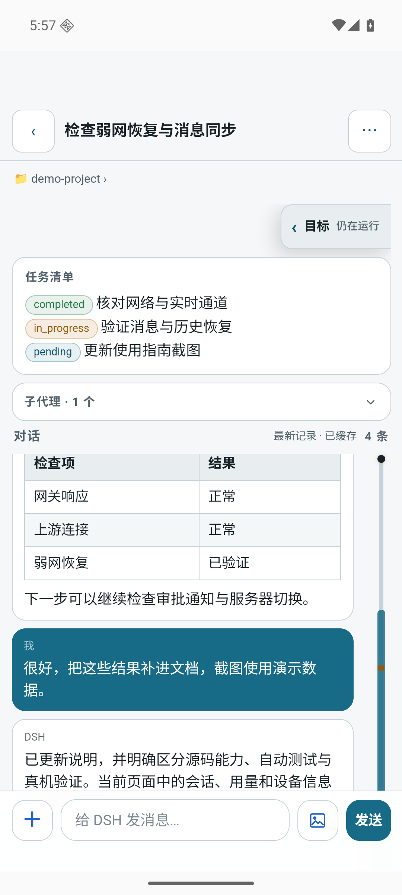 对话</td>
  </tr>
  <tr>
    <td align="center">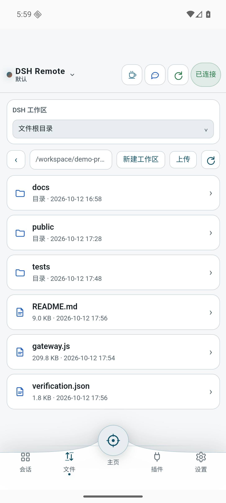 文件</td>
    <td align="center">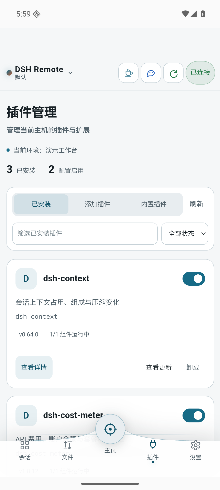 插件</td>
  </tr>
  <tr>
    <td align="center">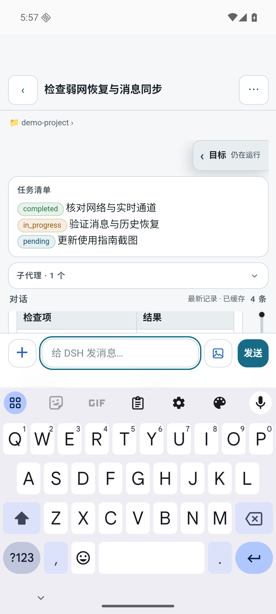 系统键盘</td>
  </tr>
</table>

## 手机 WebUI（浏览器）

视口按手机竖屏设置。截图实际尺寸为 375×812 或 390×844，逐文件尺寸以清单为准；这些是浏览器布局截图，不是 Android 或 HarmonyOS 真机截图。较长页面按当前可见区域截取，内容可在实际界面中滚动。

<table>
  <tr>
    <td align="center">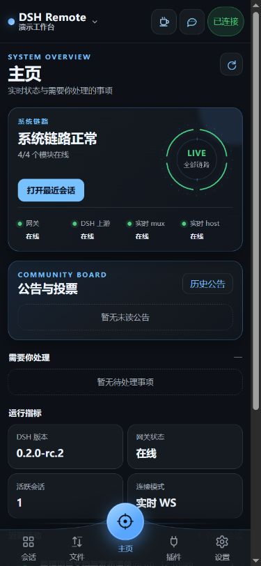 主页</td>
    <td align="center">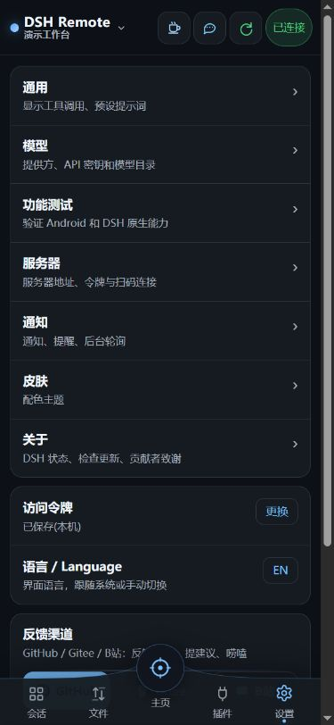 设置</td>
  </tr>
  <tr>
    <td align="center">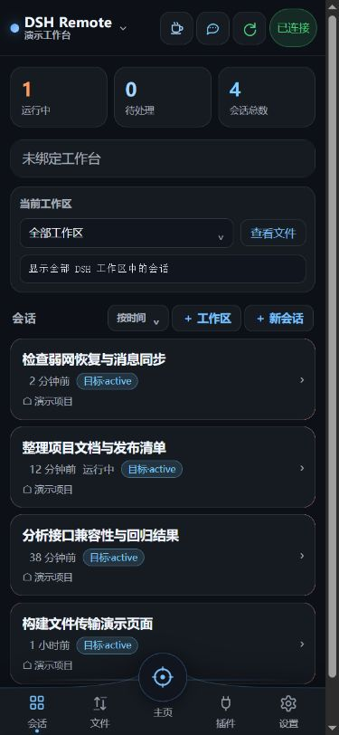 会话列表</td>
    <td align="center">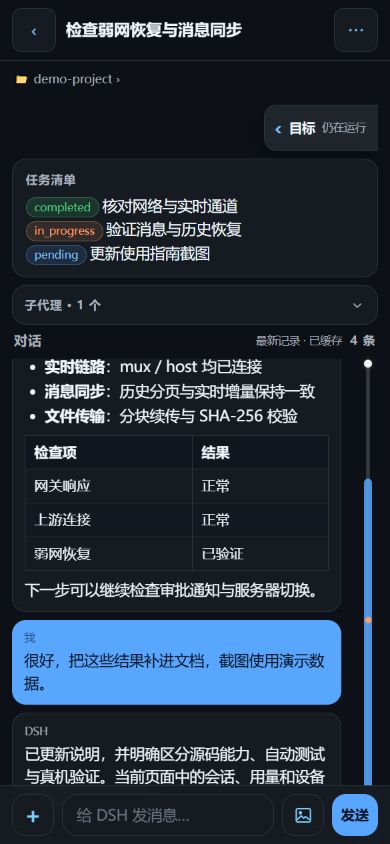 对话</td>
  </tr>
  <tr>
    <td align="center">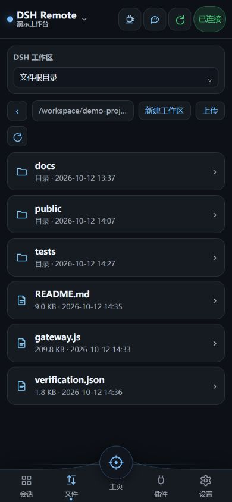 文件</td>
    <td align="center">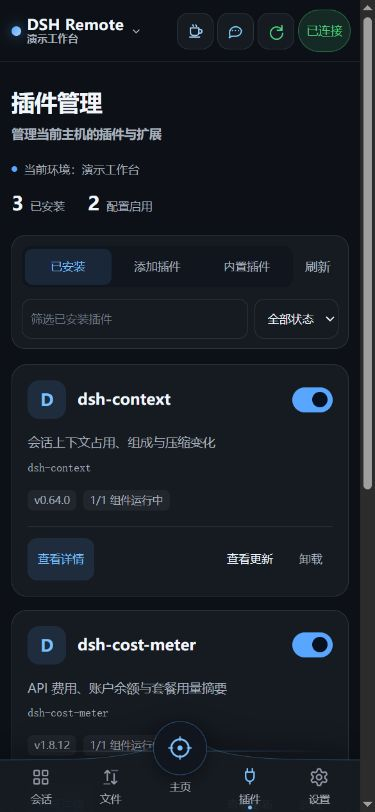 插件</td>
  </tr>
</table>

## 桌面 WebUI

桌面视口为 1440×1000；主页、工作台和插件管理均使用当前生产页面与真实交互入口。

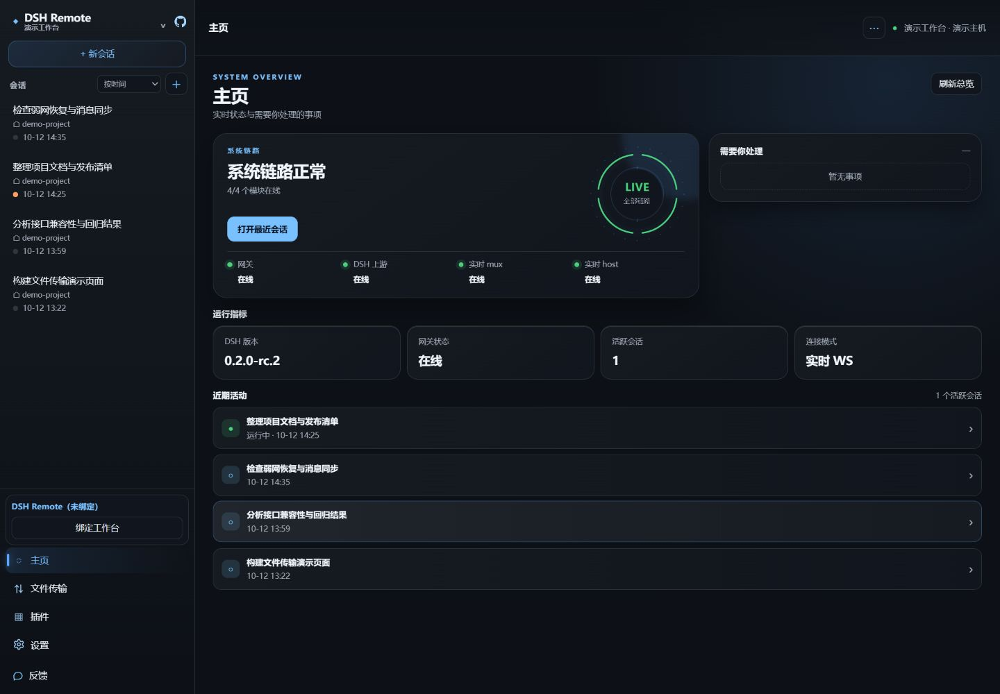

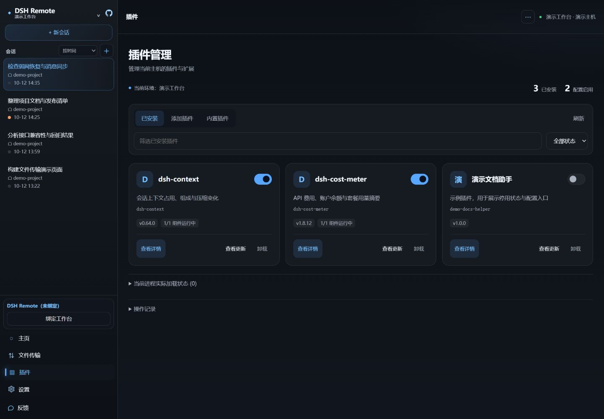

## 插件面板与管理控制台

插件面板视口 560×820。管理页视口 1440×1100，截图采用 full-page 模式；不包含右侧滚动条的实际图片宽度为 1424，展开/收起 Doctor 后高度不同。

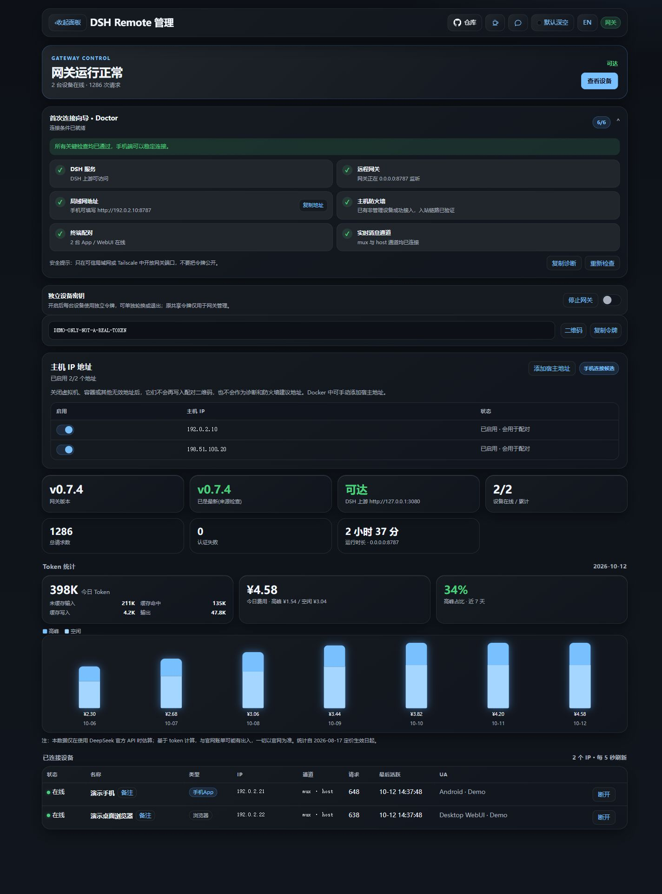

## 验证与保留范围

已逐张查看截图，确认页面已加载、导航和数据可见；实际打开手机会话、收起目标、切换主导航、关闭桌面更新说明并切换会话/插件、展开与收起 Doctor。管理页布局检查未发现横向溢出。图片文件、尺寸、SHA-256 和文档引用已核对。

Android 额外检查了 APK 安装、启动、深链配对、中文切换、主导航、会话展开/收起、系统键盘和 App 重启后连接恢复。没有重新构建 APK，没有安装 HarmonyOS HAP，也没有验收系统相机、通知、后台限制、真实设备密钥、真实 DSH 控制或实际弱网。旧 PNG 保留为历史素材，中英文项目 README 的手机图片已改用本页 Android App 截图。截图结束后关闭测试模拟器与仿真服务、清理临时网关目录；专用 AVD 和已安装的工具链保留供后续使用，生产代码和用户 profile 保持原状。
